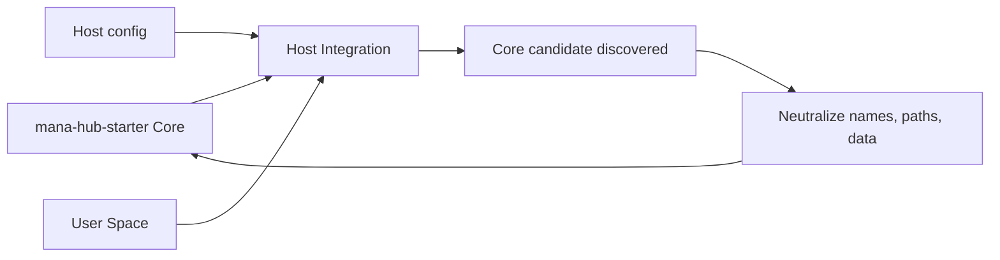

# Core/Host Sync

Mana Hub Core is the source of truth for general product behavior. Host integrations can adapt the Core, but they should not become the only place where shared fixes live.

## Rule

1. Build reusable product behavior in `mana-hub-starter` first.
2. Integrate host-specific behavior through configuration, adapters, or user space.
3. If a Core-relevant fix is discovered inside a host project, mark it as a Core candidate and port a neutral version back into `mana-hub-starter`.
4. Keep host names, private paths, production data, private avatars, and backend-specific assumptions out of Core.

## Core Candidates

Treat these as Core candidates by default:

- visual shell fixes
- sidebar behavior
- dark-mode tokens and backgrounds
- scrolling and viewport behavior
- chat lifecycle features
- upload and attachment contracts
- workspace review contracts
- documentation and install helper improvements
- schema and doctor checks

## Host-Only Changes

Keep these in the host integration:

- private navigation
- private agent names and avatars
- private data and prompts
- production backend URLs
- private bridge paths
- private MCP, cron, LaunchAgent, or runner details
- business-specific workflows

## Sync Flow



## Verification

After porting a Core candidate, run:

```bash
npm run doctor
npm run typecheck
npm run lint
npm run build
```

Then visually check the Core starter before adapting the host integration.
